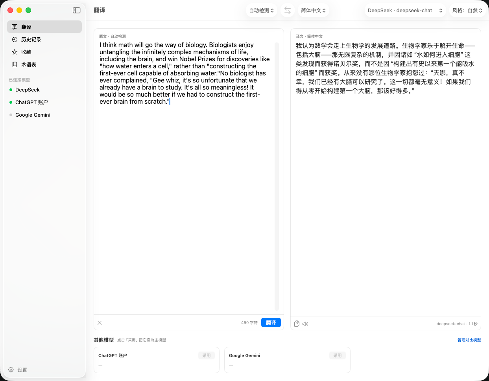
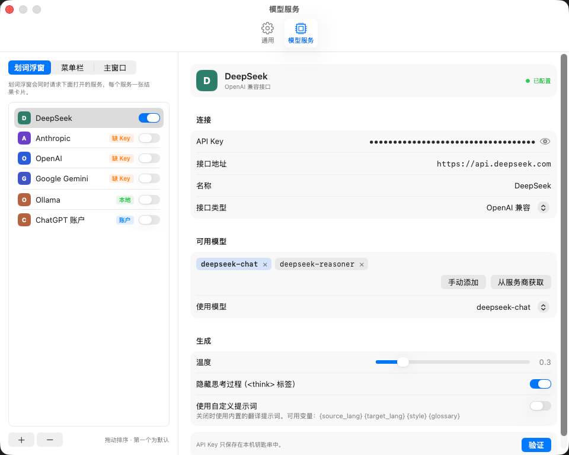

<p align="center">
  
</p>

<h1 align="center">Transory</h1>

<p align="center">一款简洁的 macOS 翻译工具，同时接入多个 AI 模型。</p>

<p align="center">
  
  
  <a href="LICENSE"></a>
  <a href="https://github.com/maple-dawn/Transory/releases"></a>
</p>

<p align="center">
  <a href="README.md">English</a> · <b>中文</b>
</p>

---

## Transory

**Transory** 是一款 macOS 原生翻译工具：选中文字就能翻译，截图也能翻译，同一句话可以交给多个 AI 模型同时翻译、对比结果。

支持 Claude、OpenAI、Gemini、DeepSeek、OpenRouter、Kimi、智谱 GLM、通义千问等云端模型，Ollama、LM Studio 等本地模型，任意 OpenAI / Anthropic 兼容接口，也可以直接**登录 ChatGPT 账户**，用订阅额度翻译，不需要 API Key。

## 截图

<p align="center">
  
</p>

<p align="center">
  
</p>

<p align="center">
  
</p>

## 功能

- **划词翻译**：在任意 App 中选中文字，按 `⌥ D`，或点鼠标旁出现的翻译按钮，就地弹出翻译浮窗。
- **多模型卡片**：浮窗里每个模型一张结果卡片，流式显示译文，可折叠、复制、朗读，或一键替换原文。
- **截图翻译**：按 `⌥ S` 框选屏幕区域，用系统 Vision 在本地识别文字（离线）；译文可以与原图并排显示，也可以直接覆盖在原图上。
- **主窗口**：输入翻译，主译文旁边是其他模型的对比结果，点「采用」即可切换主模型。
- **每个窗口单独选模型**：划词浮窗、菜单栏、主窗口各自决定用哪些服务，拖动排序，排第一的就是默认。
- **ChatGPT 账户登录**：在浏览器中完成授权即可使用，也可以改用本机已安装的 Codex CLI。
- **自动判断翻译方向**：原文已经是目标语言时（例如选中了一段中文），自动改译成英语。
- **术语表**：给产品名、人名等设置固定译法，原文中出现时会自动带进提示词。
- **历史记录与收藏**：完成的翻译自动记录，可搜索、收藏、重新打开。
- **推理模型友好**：可隐藏模型输出的 `<think>` 思考过程；支持自定义提示词和温度。
- **菜单栏快捷翻译**、**浅色 / 深色主题**、**朗读**。

## 安装

> 需要 macOS 14 Sonoma 或更高版本。

### 下载

到 [Releases](https://github.com/maple-dawn/Transory/releases) 下载最新的 `Transory-x.y.z.zip`，解压后把 `Transory.app` 拖进「应用程序」文件夹。

> [!NOTE]
> Transory 暂未使用 Apple 开发者证书签名和公证，第一次打开时 macOS 会提示「无法验证开发者」。可以任选一种方式打开：
>
> - 在「应用程序」里右键点 Transory，选「打开」，再在弹窗里点「打开」；
> - 或者先双击一次，然后到「系统设置 › 隐私与安全性」底部点「仍要打开」；
> - 或者在终端运行：`xattr -dr com.apple.quarantine /Applications/Transory.app`
>
> 之后就能正常打开了。

### 从源码构建

需要 Xcode 16 或更高版本（Swift 6）。

```bash
git clone https://github.com/maple-dawn/Transory.git
cd Transory
./scripts/bundle.sh
open build/Transory.app
```

`bundle.sh` 会编译 Release 版本，打包成 `build/Transory.app` 并做本地签名（ad-hoc）。

## 使用

| 方式 | 说明 | 默认快捷键 |
| --- | --- | --- |
| 划词翻译 | 选中文字后按快捷键，在鼠标旁弹出翻译浮窗 | `⌥ D` |
| 翻译按钮 | 拖选或双击文字后，鼠标旁出现小按钮，点击即可翻译（可在设置里关闭） | — |
| 截图翻译 | 框选屏幕区域，识别其中的文字并翻译 | `⌥ S` |
| 主窗口 | 输入或粘贴文字翻译，查看多模型对比、历史、收藏和术语表 | `⌥ Space` |
| 菜单栏 | 点菜单栏图标，快速翻译一句话 | — |

浮窗里：`Esc` 关闭，`↩` 用修改后的原文重新翻译；点左上角的图钉可以把浮窗钉住，点击别处也不会消失。

### 第一次使用

1. **开启权限**：首次启动会弹出权限引导。
   - **辅助功能**：读取其他 App 中选中的文字、替换原文。
   - **屏幕录制**：截图翻译。授权后需要重新打开 Transory。
2. **添加模型服务**：打开「设置 › 模型服务」，点左下角 `+` 选择服务，填好 API Key，点「从服务商获取」选择模型，再点「验证」。
3. **为每个窗口选择服务**：在服务列表上方切换「划词浮窗 / 菜单栏 / 主窗口」，用开关决定该窗口使用哪些服务。

> 如果「系统设置」里已经有 Transory 但仍提示未授权（例如更新或重新构建过 App），请先把它从列表中移除，再重新添加。

## 支持的服务

| 类型 | 服务 |
| --- | --- |
| 云端（需要 API Key） | Anthropic Claude、OpenAI、Google Gemini、DeepSeek、OpenRouter、硅基流动、Kimi、智谱 GLM、通义千问 |
| 本地（无需 Key，离线可用） | Ollama、LM Studio |
| 自定义 | 任意 OpenAI 兼容接口、任意 Anthropic 兼容接口 |
| 账户登录 | ChatGPT 账户（内置浏览器登录 / 本机 Codex CLI） |

### 关于 ChatGPT 账户

「ChatGPT 账户」服务有两种接入方式：

- **ChatGPT 登录（内置）**：Transory 在浏览器中完成 OpenAI 的 OAuth 授权，令牌保存在本机钥匙串中，直接调用 ChatGPT 的 Codex 服务。
- **本机 Codex CLI**：调用已安装的 [Codex CLI](https://github.com/openai/codex)（`npm install -g @openai/codex`），登录由 Codex 自己管理。

> [!WARNING]
> 内置登录使用的是 Codex 的客户端身份和非公开接口，这种用法可能不符合 OpenAI 的使用条款，接口也可能随时变化而失效。请自行评估风险；如果内置方式不可用，可以切换到「本机 Codex CLI」。

## 隐私

- API Key 和登录令牌只保存在 macOS 钥匙串中。
- 翻译请求从你的 Mac 直接发给你选择的服务商，不经过任何第三方服务器。
- 截图文字识别完全在本地完成。
- Transory 不收集任何使用数据。

## 开发

```bash
swift run Transory    # 直接运行（调试版）
swift test            # 运行单元测试
```

也可以用 Xcode 直接打开 `Package.swift`。

```
Sources/
  TransoryCore/      与界面无关的核心逻辑
    Providers/         各服务的适配器（OpenAI 兼容、Anthropic、Gemini）
    Codex/             ChatGPT 账户：OAuth 登录、Codex 接口、Codex CLI
    Translation/       翻译会话、多模型并发、语言识别、思考内容过滤
    OCR/               Vision 文字识别
  Transory/          SwiftUI App：主窗口、浮窗、截图翻译、设置、权限引导
Tests/               单元测试（用假的网络层和假的 codex 脚本，不发真实请求）
scripts/
  bundle.sh          打包 App
  make-icon.swift    生成 App 图标
```

**接入新的服务**：兼容 OpenAI 接口的服务不用写代码，在设置里添加「自定义 OpenAI 兼容」即可；其他协议实现 `StreamingProvider` 的 `makeURLRequest(for:)` 和 `parse(_:)`，并在 `ProviderKind`、`ProviderFactory` 里各加一项。

**界面快照**：调试版设置环境变量 `TRANSORY_SNAPSHOT_DIR` 启动，会把主要窗口渲染成 PNG 后退出（使用内存数据和假模型，不读写真实设置、不访问钥匙串）：

```bash
TRANSORY_SNAPSHOT_DIR=/tmp/shots swift run Transory
```

## 贡献

欢迎提交 Issue 和 Pull Request。提交 PR 前请确认 `swift build` 无警告、`swift test` 全部通过。

## 许可证

基于 [MIT 许可证](LICENSE) 开源。
